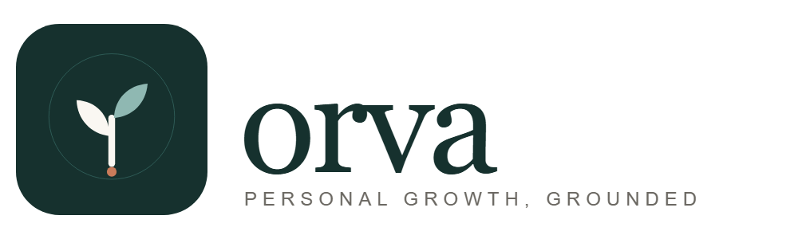
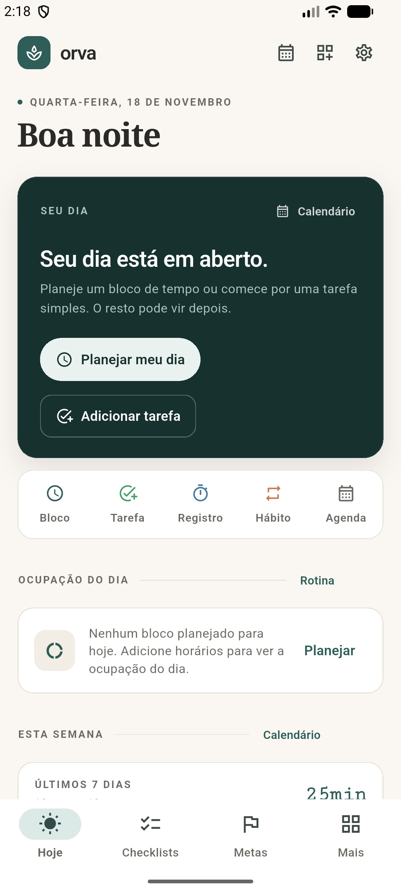
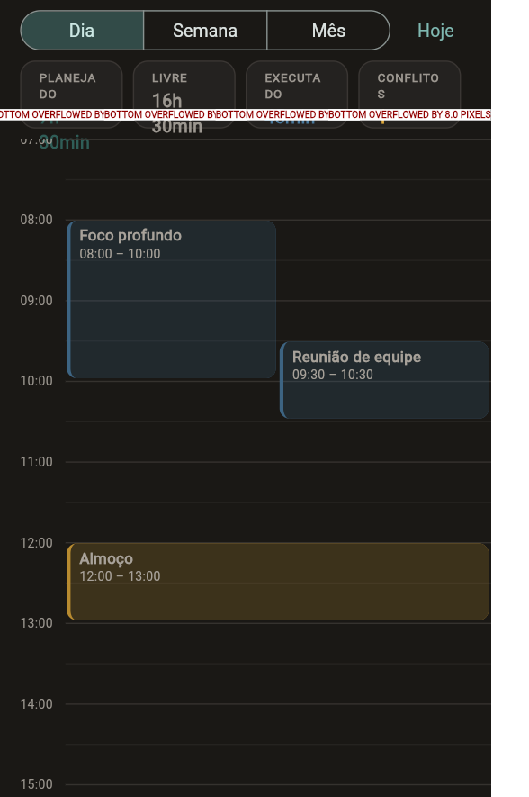
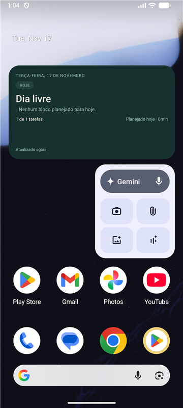

<p align="center">
  
</p>

<p align="center">
  <strong>Private-by-default personal growth, grounded in real records.</strong><br>
  Plan your time. Track what actually happened. See honest progress — all on your device.
</p>

<p align="center">
  
  
  
  
</p>

## What is Orva?

Orva is a local-first personal growth system built with Flutter. It connects daily
planning, real activity records, goals, habits, hobbies, studies, notes and a
behavioral self-comparison into one quiet command center.

It is **not** a social network, a medical authority or a productivity scoreboard.
The product follows a few non-negotiable principles:

- **Evidence before appearance.** Every metric comes from a real record or is
  clearly marked as manual input.
- **Planned time is not completed time.** Execution requires an actual record.
- **One source of truth.** A fact is stored once and projected where it is needed.
- **Local-first and private.** Core flows work offline and require no account.
- **Honest empty states.** Missing data is unknown, not failure.
- **User agency.** No shame, no diagnosis, no compulsive tracking.

## Screenshots

| Home | Calendar | Android widget |
|:---:|:---:|:---:|
|  |  |  |

## Features

| Area | What it does |
|---|---|
| **Home** | Daily command center: planned vs. executed time, 24h ribbon, next activity, day timeline, priorities, day-allocation chart, weekly hobbies, habit consistency, goals and study evidence. |
| **Calendar & time blocking** | Day, week and month views over routine blocks, obligations, meals and real executions. Overlap detection, overnight intervals and free-time calculation. |
| **Checklists & routines** | One-off lists, daily/specific-weekday recurrence and reusable templates; per-occurrence completion and history. Routine blocks can be weekday- or date-specific. |
| **Goals** | Progress history, categories, deadlines, parent goals, completion, reopening and archiving. |
| **Habits** | Quantitative habits with custom units, active weekdays and a rolling 7-day consistency view. |
| **Hobbies** | Weekly targets and real session records, with weekly totals on Home. |
| **Studies** | Subjects, topics, sessions and reviews, feeding study evidence on Home. |
| **Nutrition** | Food catalogue, planned meals and recorded consumption. |
| **Notes & journal** | Local notes with tags and search; one journal entry per date with optional mood. |
| **Alter egos** | Fixed Beto-vs-Alfredo comparison with explicit periods, weighted traits, manual check-ins and habit/study-derived evidence. |
| **Android widgets** | Eight launcher widgets (Today, Tasks, Progress, Beto vs. Alfredo, Goals, Habits, Studies, Agenda) rendered from a sanitized, versioned snapshot. |
| **Backup & lock** | Versioned JSON export/import inside a transaction, local PIN/biometric lock and sanitized diagnostics. |

> Notifications, missions/XP, cloud sync and AI are roadmap items, not shipped
> features. See [`docs/product/ROADMAP.md`](docs/product/ROADMAP.md).

## Tech stack

| Layer | Choice |
|---|---|
| UI | Flutter, Material 3, custom Orva theme and design tokens |
| State | Riverpod (`flutter_riverpod`) |
| Persistence | Drift over local SQLite, explicit schema and migrations |
| Dates | `intl` with `pt_BR` locale |
| Backup | `file_picker`, `cross_file`, `share_plus` |
| Security | `local_auth` for biometrics; local PIN flow |
| Optional cloud | Firebase Core/Auth and Google Sign-In, initialized opportunistically |
| Platform | Android (primary), with MethodChannel + RemoteViews widgets |

No code generation is required: the Drift schema and migrations live in
`lib/core/database/app_database.dart`, currently at schema **v6**. Backups use
format **v6** and can import v3–v5.

## Requirements

- **Flutter SDK** with Dart **3.13.5 or newer** (`environment.sdk: ^3.13.5`).
- **Android SDK** with an emulator or device. The app uses `minSdk 24`
  (Android 7.0), `targetSdk 36` and **Java 17**.
- For iOS/macOS builds: Xcode and CocoaPods on macOS (not validated in CI).
- Optional: a local Firebase configuration if you want to exercise the optional
  authentication scaffolding. The app still starts without it.

Check your environment:

```bash
flutter doctor
```

## Getting started

```bash
git clone https://github.com/guiguix7/Orva.git
cd Orva

flutter pub get
flutter analyze
flutter test

# Run on a connected device or emulator
flutter run
```

Build an Android APK:

```bash
flutter build apk --debug     # development
flutter build apk --release   # release APK
```

Run the integration flow (create, read and delete a note):

```bash
flutter test integration_test/app_flow_test.dart
```

All commands are run from the repository root. Current releases are published on
the [GitHub Releases page](https://github.com/guiguix7/Orva/releases).

## Project structure

```text
lib/
├── main.dart                 # bootstrap, locale, optional Firebase, error zone
├── app.dart                  # shell, navigation and widget sync lifecycle
├── core/
│   ├── database/             # Drift schema, migrations and repositories
│   ├── domain/               # pure calculations (home, calendar, comparison…)
│   ├── platform/             # widget bridge and snapshot synchronization
│   ├── security/             # local lock and access control
│   ├── theme/                # colors, typography, spacing and motion tokens
│   ├── widgets/              # shared Orva UI components
│   └── logging/              # local, sanitized diagnostics
├── features/
│   ├── home/                 # command center and quick actions
│   ├── calendar/ routine/    # time blocking, agenda and templates
│   ├── checklists/           # lists, occurrences and history
│   ├── goals/ habits/ hobbies/
│   ├── studies/ nutrition/
│   ├── notes/ journal/ quotes/
│   ├── comparison/           # Beto vs. Alfredo
│   ├── executions/ countdowns/
│   ├── obligations/          # recurring obligations and exceptions
│   └── settings/ profile/ security/
android/                      # Android host, widgets, layouts and resources
test/                         # unit and widget tests
integration_test/             # on-device flow tests
docs/                         # product, architecture, specs and assets
assets/branding/              # vector logo and mark
```

## Data and privacy

- Data lives in a **local SQLite database** on the device. There is no account
  requirement, cloud sync or telemetry in the core flows.
- Journal, notes, health, nutrition and behavioral records are never written to
  logs, widgets or notifications.
- Android widgets render a **sanitized snapshot**; when the app lock is enabled,
  sensitive content is withheld.
- **SQLite is not encrypted at rest.** The PIN/biometric lock protects access to
  the app, not the database file. Do not describe it as encryption.
- Backup import validates the format/version, confirms the replacement and runs
  inside a transaction; any failure rolls back.

Read [`PRIVACY.md`](PRIVACY.md) and [`SECURITY.md`](SECURITY.md) for the full
policy and how to report a vulnerability.

## Quality and validation

```bash
dart format .
flutter analyze
flutter test
flutter build apk --debug
```

CI runs dependency resolution, formatting, static analysis, the test suite and an
Android debug build (`.github/workflows/flutter-validation.yml`). Analyze must
have **no errors or warnings**; pre-existing infos are non-blocking.

Schema changes require forward, non-destructive migrations plus tests for old
schemas, rows, constraints and backup compatibility. Widget changes require a
native build and emulator/device lifecycle checks.

## Documentation

| Document | Purpose |
|---|---|
| [`docs/product/PRODUCT_VISION.md`](docs/product/PRODUCT_VISION.md) | Product direction and principles |
| [`docs/product/ROADMAP.md`](docs/product/ROADMAP.md) | Priorities and future phases |
| [`docs/agents/CURRENT_STATE.md`](docs/agents/CURRENT_STATE.md) | Verified repository state |
| [`docs/specs/`](docs/specs/) | Feature behavior contracts |
| [`docs/quality/DEFINITION_OF_DONE.md`](docs/quality/DEFINITION_OF_DONE.md) | Acceptance gates |
| [`docs/architecture/ACTIVITY_AND_PROGRESS_ARCHITECTURE.md`](docs/architecture/ACTIVITY_AND_PROGRESS_ARCHITECTURE.md) | Activity/progress model |

## Contributing

Contributions are welcome. Read [`CONTRIBUTING.md`](CONTRIBUTING.md) before opening
an issue or pull request, and follow the [`CODE_OF_CONDUCT.md`](CODE_OF_CONDUCT.md).

In short: keep changes small and testable, preserve user data, never weaken
privacy, and run the checks above before submitting.

## License

No open-source license has been published for this repository yet. Until one is
added, the code is available for viewing and personal evaluation only; do not
redistribute or reuse it commercially without the author's permission.
